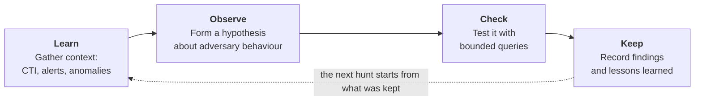
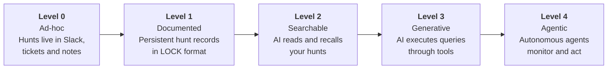

# Hecate

Hecate provides structure and persistence for threat hunting programs. It's a markdown-based framework, wrapped in a Python CLI, that enables AI-powered threat hunting.

## 🚀 Quick Start

```bash
# Install from PyPI
pip install hecate-agent

# Or install with all optional capabilities (AI, STIX, MCP)
pip install "hecate-agent[all]"

# Zero-configuration demo: initialize complete example hunt
hecate-agent demo init

# Assess your workspace maturity level
hecate-agent maturity assess

# Interactive AI configuration wizard (OpenAI / Anthropic / local Ollama)
hecate-agent config ai

# Export validated hunting logic to a Sigma detection rule
hecate-agent hunt promote --hunt H-0001 --output sigma
```

Pre-built wheel and sdist distributions are also available on [GitHub Releases](https://github.com/BrizoSec/Hecate-Core/releases), or you can install from source for development:

```bash
git clone https://github.com/BrizoSec/Hecate-Core.git
cd Hecate-Core
pip install -e .
```

To check that a workspace has the optional dependencies its commands actually need, run `hecate-agent env check`.

For more detailed instructions, see the [Getting Started Guide](docs/getting-started.md).

**Joining the project?** Read the [onboarding guide](docs/ONBOARDING.md): what
Hecate is for, how this repository and Hecate-Runner fit together, and how to
get to a first drafted hunt.

## Key Features

* **Structured Hunting:** Documents hunts using the LOCK pattern (Learn → Observe → Check → Keep).
* **Searchable Repository:** Maintains a searchable repository of past investigations.
* **AI-Assisted:** Optional research and hypothesis generation agents use configured LLM and search providers.
* **Extensible:** Supports platform-specific workflows and optional plugins.
* **Observable:** `hecate-agent monitor` is a live terminal dashboard of an automated pipeline run.

## The LOCK Pattern

Every threat hunt follows the same basic loop: **Learn → Observe → Check → Keep**.



This structure makes it possible for AI assistants to recall prior work and suggest refined queries based on past results. For more details, see the [LOCK Pattern Guide](docs/lock-pattern.md).

## The Five Levels of Agentic Hunting

Hecate defines a simple maturity model to help you assess and improve your threat hunting capabilities.



Most teams will live at Levels 1–2. Everything beyond that is optional maturity. For more details, see the [Maturity Model Guide](docs/maturity-model.md).

## Division of Labor: Hecate-Core vs. Hecate-Runner

Hecate is designed in clear modular layers:

* **Hecate-Core** (`hecate-agent`): The foundational threat hunting engine, Markdown repository, LOCK lifecycle manager, detection rule exporter, and MCP tools.
* **Hecate-Runner**: The autonomous orchestrator that continuously monitors CTI feeds, drives hypothesis generation, and drafts hunts into Hecate-Core workspaces.

| Scenario | Recommended Component |
|---|---|
| **Manually write hunts and conduct research** | **Hecate-Core** |
| **Automatically pull CTI and draft hunts** | **Hecate-Runner + Core** |
| **Want a live monitoring dashboard** | **Core's monitor command** (`hecate-agent monitor`) |

For version compatibility matrices and workspace stability guarantees, see [docs/COMPATIBILITY.md](docs/COMPATIBILITY.md).

## Documentation

* [Onboarding for new joiners](docs/ONBOARDING.md)
* [Architecture and design diagrams](https://github.com/BrizoSec/Hecate-Runner/blob/main/docs/ARCHITECTURE.md)
* [Getting Started](docs/getting-started.md)
* [Installation](docs/INSTALL.md)
* [Version Compatibility Policy](docs/COMPATIBILITY.md)
* [CLI Reference](docs/CLI_REFERENCE.md)
* [Configuration](docs/CONFIGURATION.md)
* [LOCK Pattern](docs/lock-pattern.md)
* [Maturity Model](docs/maturity-model.md)
* [Using Hecate](docs/USING_HECATE.md)
* [Integrations](integrations/README.md)

## Related repositories

* [Hecate-Runner](https://github.com/BrizoSec/Hecate-Runner) — autonomous orchestrator that drafts hunts into this workspace from live CTI.

## Acknowledgements

Hecate began as a fork of the MIT-licensed Agentic Threat Hunting Framework
(ATHF) by Sydney Marrone at Nebulock, which introduced the LOCK pattern and the
five-level maturity model. It is now developed independently and does not
track or depend on that project.

## Contributing

Issues and pull requests are welcome on [BrizoSec/Hecate-Core](https://github.com/BrizoSec/Hecate-Core).

## License

MIT, per the `license` field in `pyproject.toml`.
