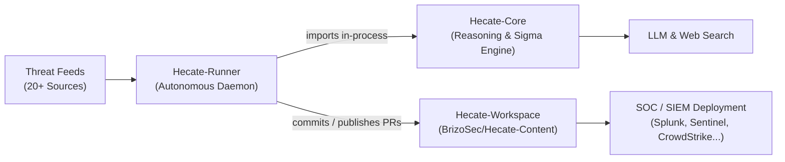

# Hecate-Core

> **The Agentic Detection Engineering & Threat Hunting Reasoning Engine.**
> Python library, CLI, and prompt framework powering autonomous detection generation from threat intelligence.

[](https://www.python.org/downloads/)
[](https://opensource.org/licenses/MIT)
[](https://github.com/astral-sh/ruff)

---

## 🧭 Overview

**Hecate-Core** (`hecate_agent`) is the foundation of the Hecate threat hunting ecosystem. It provides the core agent reasoning loops, prompt templates, MITRE ATT&CK knowledge graphs, Sigma rule generation, and pySigma transpilation to multi-engine SIEM/EDR query languages.

It operates under a strict principle: **The LLM proposes, deterministic code disposes.** Models draft behavioral hypotheses and candidate detections; deterministic AST parsers, schema validators, and grounding auditors verify and tune every artifact.

---

## 🏛 Ecosystem Architecture

Hecate is structured into three coordinated repositories:



- **[Hecate-Core](https://github.com/BrizoSec/Hecate-Core)** *(this repo)*: Detection reasoning library, CLI, Sigma generation, MITRE ATT&CK STIX grounder, pySigma transpiler.
- **[Hecate-Runner](https://github.com/BrizoSec/Hecate-Runner)**: Autonomous perpetual daemon, 20+ CTI intake feeds, purple team emulation, automated reviewer self-remediation, GitHub PR publisher, Slack bot.
- **[Hecate-Workspace](https://github.com/BrizoSec/Hecate-Content)**: Version-controlled detection repository holding hunts (`hunts/`), queries (`queries/`), research briefs (`research/`), and promotion policies.

---

## 📂 File & Directory Structure

```text
Hecate-Core/
├── hecate_agent/                # Primary Python package
│   ├── agents/                  # Autonomous LLM agents (Hypothesis, Researcher, Reviewer)
│   ├── commands/                # CLI subcommands (hunt, attack, investigate, monitor)
│   ├── core/                    # Deterministic engines (grounding, AST validation, transpiler)
│   ├── mcp/                     # Model Context Protocol (MCP) server & tool integrations
│   ├── utils/                   # Validation & helper utilities
│   ├── api.py                   # High-level Python programmatic API
│   └── cli.py                   # Typer CLI entrypoint
├── docs/                        # Complete technical documentation
│   ├── ARCHITECTURE.md          # 3-repo architecture blueprint & data flow
│   ├── FEATURES.md              # Exhaustive feature matrix and subsystem details
│   ├── CHALLENGES.md            # Technical challenges solved (hallucinations, token quotas)
│   ├── HOW_TO.md                # Developer recipes & step-by-step guides
│   ├── ONBOARDING.md            # Fast-track onboarding guide for new joiners
│   └── CLI_REFERENCE.md         # Comprehensive CLI argument reference
├── evals/                       # Ground-truth evaluation pulses and replay scripts
├── knowledge/                   # OCSF schemas, ATT&CK STIX cache, hunting knowledge
├── prompts/                     # System prompts and few-shot templates
└── tests/                       # 1,900+ unit and integration tests
```

---

## 🚀 Quick Start

### 1. Installation

Clone alongside its sibling repositories and install with [uv](https://docs.astral.sh/uv/):

```bash
git clone https://github.com/BrizoSec/Hecate-Core.git
cd Hecate-Core

# Install with all optional extras (ATT&CK STIX, pySigma backends, MCP)
uv sync --all-extras
```

### 2. Environment Configuration

Copy the example configuration to your workspace `.env`:

```bash
cp .env.example .env
```

Set your model and search API keys:

```dotenv
HECATE_AI_PROVIDER=anthropic      # or openai, bedrock, ollama
ANTHROPIC_API_KEY=sk-ant-...
TAVILY_API_KEY=tvly-...          # For web-grounded research
HECATE_WORKSPACE=/path/to/Hecate-Workspace
```

Verify your environment dependencies:

```bash
uv run hecate-agent env check
```

---

## 💻 CLI Usage (`hecate-agent`)

The `hecate-agent` CLI gives detection engineers interactive access to the reasoning engine:

### Manage & Explore Hunts
```bash
# List all recorded hunts across quarters
uv run hecate-agent hunt list

# Inspect a specific hunt
uv run hecate-agent hunt show H-0885

# Promote a hunt and transpile Sigma rules to SIEM queries
uv run hecate-agent hunt promote --hunt H-0885 --output splunk
uv run hecate-agent hunt promote --hunt H-0885 --output sentinel
uv run hecate-agent hunt promote --hunt H-0885 --output crowdstrike
```

### MITRE ATT&CK Matrix & Search
```bash
# Search ATT&CK techniques by keyword or identifier
uv run hecate-agent attack search "credential dumping"

# Inspect technique coverage and mapped data sources
uv run hecate-agent attack show T1003.001
```

### Live Terminal Monitoring Dashboard
```bash
# Launch interactive curses-based TUI monitoring pipeline activity
uv run hecate-agent monitor
```

---

## 🐍 Python API Usage

Hecate-Core exposes a clean programmatic API in [`hecate_agent.api`](file:///home/chemch/betas/Hecate-Core/hecate_agent/api.py):

```python
from hecate_agent.api import (
    generate_hypothesis,
    generate_sigma_rules,
    transpile_sigma_rule,
)

# 1. Generate a grounded hypothesis from threat intelligence
hypothesis = generate_hypothesis(
    title="Salt Typhoon Cisco Router Backdoor",
    cti_text="Adversaries deployed GhostHook backdoor via CVE-2026-1934 into /tmp/gh.elf...",
)

# 2. Draft candidate Sigma detection rules
rules = generate_sigma_rules(hypothesis=hypothesis)

# 3. Transpile Sigma YAML into target SIEM dialects
for rule in rules:
    splunk_spl = transpile_sigma_rule(rule.yaml, target="splunk")
    sentinel_kql = transpile_sigma_rule(rule.yaml, target="sentinel")
    print(f"Generated Splunk SPL:\n{splunk_spl}")
```

---

## 🧪 Testing & Verification

The test suite runs offline without requiring network calls or paid API credits:

```bash
# Run full test suite (1,900+ tests)
uv run pytest -q

# Run with coverage report
uv run pytest --cov=hecate_agent tests/
```

---

## 📚 Complete Documentation

- **[System Architecture](docs/ARCHITECTURE.md)**: Three-repository design, lifecycle diagrams, and agent graphs.
- **[Feature Reference](docs/FEATURES.md)**: Exhaustive breakdown of ingestion, dual-track scheduling, and evaluation.
- **[Engineering Challenges](docs/CHALLENGES.md)**: Deep dive into hallucination defense, token economics, and telemetry synthesis.
- **[Developer How-To Guides](docs/HOW_TO.md)**: Step-by-step recipes for adding CTI feeds, SIEM targets, and local evals.
- **[New Developer Onboarding](docs/ONBOARDING.md)**: Getting started guide for new joiners.
- **[CLI Reference](docs/CLI_REFERENCE.md)**: Full argument documentation for every CLI command.

---

## 📄 License

MIT License. See [LICENSE](LICENSE) for details.
