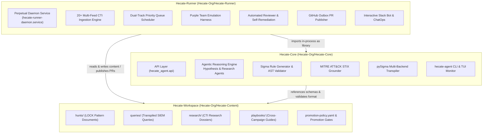
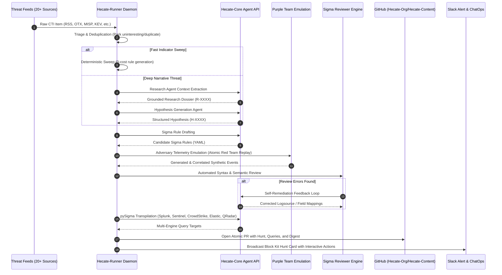
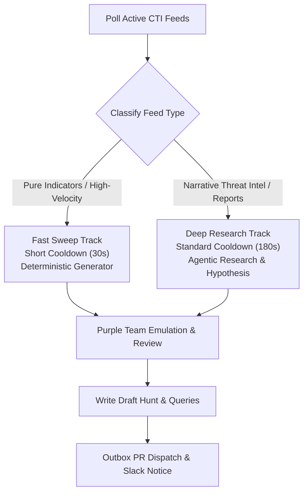

# Hecate Platform Architecture

An architectural blueprint of the Hecate autonomous detection engineering and threat hunting platform.

---

## 1. Executive Summary

**Hecate** is an autonomous, agentic detection engineering ecosystem. It bridges the gap between raw Cyber Threat Intelligence (CTI) and production-grade detection content across modern Security Information and Event Management (SIEM) and Endpoint Detection and Response (EDR) platforms.

Hecate is designed around a core tenet: **The LLM proposes, deterministic code disposes.** Generative AI models propose hypotheses, extract threat behaviors, and draft candidate detection logic; deterministic static analysis engines, AST validators, MITRE ATT&CK grounders, and telemetry emulators verify, tune, and test every generated artifact before it reaches human review or production promotion.

---

## 2. The Three-Repository Topology

The platform is partitioned into three distinct repositories with decoupled responsibilities:

### 2.1 Repository Summary

| Repository | Python Package | Primary Role | Key Artifacts |
|---|---|---|---|
| **[`Hecate-Core`](file:///home/chemch/betas/Hecate-Core)** | `hecate_agent` | Core detection reasoning library, prompt engine, MITRE ATT&CK grounding, Sigma generator, and pySigma transpiler. | `hecate-agent` CLI, agent modules, prompt templates, evaluation harness. |
| **[`Hecate-Runner`](file:///home/chemch/betas/Hecate-Runner)** | `hecate_runner` | Autonomous orchestrator, perpetual daemon, 20+ CTI intake feeds, purple-team adversary emulation, reviewer auto-remediation, GitHub publisher, Slack bot. | `hecate-runner` CLI, daemon service, CTI pollers, emulation runners, PR publisher. |
| **[`Hecate-Workspace`](file:///home/chemch/betas/Hecate-Workspace)** | *(Content Repo)* | Central version-controlled detection engineering repository (`Hecate-Org/Hecate-Content`). | `hunts/` (LOCK markdown), `queries/` (Sigma & SIEM queries), `research/` dossiers, `promotion-policy.yaml`. |

---

## 3. End-to-End Lifecycle & Data Flow

From the arrival of an external intelligence pulse to a verified SIEM detection query in production, Hecate runs a multi-stage deterministic pipeline:

---

## 4. Key Subsystem Architectures

### 4.1 Autonomous Daemon & Dual-Track Queue

The perpetual daemon ([`hecate_runner.orchestrator`](file:///home/chemch/betas/Hecate-Runner/src/hecate_runner/orchestrator.py)) runs as a resilient systemd background service (`hecate-runner-daemon.service`).

- **Dual-Track Priority:** High-volume indicator feeds (e.g. ThreatFox, MalwareBazaar) bypass heavy LLM research and invoke fast deterministic sweeps, preserving LLM token budgets and Tavily search credits for complex narrative advisories.
- **State Persistence:** Feed cursor positions, processed pulse IDs, and daily quotas are atomically committed to `.cursors/` and `.orchestrator_state.json`.

### 4.2 Grounding & Anti-Hallucination Framework

To guarantee detection fidelity, Hecate enforces strict verification boundaries in [`hecate_agent.core.grounding`](file:///home/chemch/betas/Hecate-Core/hecate_agent/core/grounding.py) and [`hecate_runner.claim_provenance`](file:///home/chemch/betas/Hecate-Runner/src/hecate_runner/claim_provenance.py):

1. **Source Evidence Extraction:** CTI text and primary web sources are parsed for exact regex matches against processes, command lines, hashes, IPs, domains, and registry keys.
2. **Verbatim Claim Auditing:** Any rule or hypothesis asserting that an attacker executed a specific artifact must have that artifact present in the verified source text; inferred techniques are explicitly labeled `grounding: inferred`.
3. **Platform Protects Heuristic:** Dual-use administrative tools (e.g. `whoami.exe`, `net.exe`, `curl`) require specific malicious context or command-line parameters to avoid generating noisy, un-tunable detection rules.

### 4.3 Automated Reviewer & Self-Remediation Loop

In [`hecate_agent.agents.llm.sigma_generator`](file:///home/chemch/betas/Hecate-Core/hecate_agent/agents/llm/sigma_generator.py) and [`hecate_runner.rule_tuner`](file:///home/chemch/betas/Hecate-Runner/src/hecate_runner/rule_tuner.py):

1. **Syntactic Validation:** Every generated Sigma YAML rule is loaded into a strict AST parser to prevent invalid syntax or malformed YAML keys.
2. **Platform & Logsource Correction:** When a rule specifies an ambiguous platform or mismatched logsource (e.g. Linux auditd fields on a Windows process creation rule), the reviewer engine passes remediation error messages back to the LLM generator to regenerate corrected definitions.
3. **pySigma Backend Compatibility:** The rule is test-transpiled across all 5 target SIEM dialects. If a backend fails due to an unsupported condition modifier or wildcard placement, the rule is automatically tuned.

### 4.4 Purple-Team Telemetry Replay

In [`hecate_runner.purple_team`](file:///home/chemch/betas/Hecate-Runner/src/hecate_runner/purple_team.py):
- For every generated hunt, Hecate simulates the adversary technique using Atomic Red Team definitions and synthetic telemetry generators.
- Synthesizes realistic events for:
  - **Process Creation:** Sysmon Event ID 1, Windows 4688, Linux auditd `execve`.
  - **File Operations:** Sysmon Event ID 11, auditd file write.
  - **Network Connections:** Sysmon Event ID 3, Zeek `conn.log`, Firewall logs.
  - **Web Application / WAF:** Apache/Nginx access logs and Cloudflare/ModSecurity WAF events.
- Evaluates candidate Sigma rules against the synthetic telemetry to verify true-positive detection prior to human submission.

---

## 5. Security & Isolation Model

- **Zero-Unattended Execution:** The pipeline generates `status: planning` hunts and candidate queries. No query or remediation command is executed against production SIEMs without authenticated human confirmation.
- **Atomic Operations:** All file updates utilize atomic temporary-write-and-rename patterns (`atomic_write_text`) with flock guards to eliminate corruption risks during system interruptions.
- **Secret Isolation:** API tokens, GitHub App private keys, and SIEM credentials reside in secure `.env` files or `/run/secrets/` and are never committed to version control.
