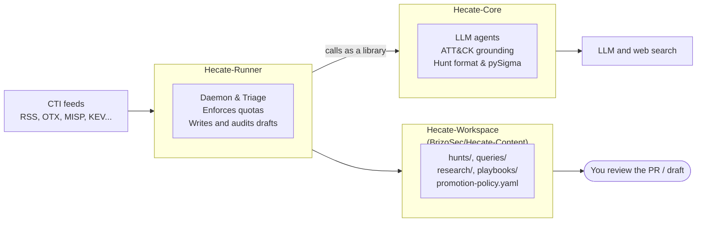

# Onboarding: start here

For someone joining the project. It explains what Hecate is for, how the
pieces fit, and how to get from two fresh clones to watching a hunt being
drafted. Budget about an hour, most of it waiting on installs and one model run.

## What Hecate is for

Threat intelligence arrives faster than a hunting team can read it. A vendor
publishes a report on a new intrusion; somebody has to read it, work out what
the attacker actually did, decide which of our logs would show it, and write
the queries. Most reports never get that far, and the ones that do leave no
record of what was checked.

Hecate does the first draft of that work, continuously, and keeps the record:

1. It reads threat intelligence feeds.
2. For each item worth hunting, it reads the underlying report, researches the
   technique, and writes a **draft hunt**: a hypothesis, the ATT&CK techniques
   involved, the telemetry that would show it, and candidate Sigma detection
   rules.
3. It marks every claim in the draft by where it came from, so a reviewer can
   see at a glance what the source said and what the model inferred.
4. It stops there. A human reviews the draft. Nothing is ever run against a
   production system without a person proposing and approving it.

The design rule that explains most of the code: **the model proposes,
deterministic code disposes.** The model writes prose and candidate rules.
Everything checkable (does this technique exist, does this indicator appear in
the source, is this valid Sigma) is checked by ordinary code, and what fails is
dropped.

## The Three Repositories



| | Hecate-Core (this repo) | Hecate-Runner | Hecate-Workspace |
|---|---|---|---|
| Package / Repo | `hecate_agent` | `hecate_runner` | `BrizoSec/Hecate-Content` |
| CLI / Service | `hecate-agent` | `hecate-runner` (`hecate-runner-daemon.service`) | Git PR & Promotion Gate |
| Primary Role | Reasoning library, ATT&CK matrix, Sigma generator, pySigma transpiler, CLI | Autonomous perpetual daemon: CTI intake, triage, adversary emulation, reviewer remediation, Slack bot | Central version-controlled content repo holding hunts, Sigma rules, SIEM queries, and research briefs |
| Knows about feeds | No | Yes | No |
| Usable alone | Yes, for manual hunting & CLI commands | No, it drives Core | Yes, for SIEM query consumption |

Key principles to remember:

- **Hecate-Workspace is the single source of truth for detections.** Drafted hunts land in its
  `hunts/`, research in `research/`, and transpiled SIEM queries in `queries/`.
- **The Runner imports Core in-process; it does not shell out to it.** Core's optional
  dependencies are installed in the *Runner's* virtualenv automatically via path dependency.
- **For architecture and recipes**, see [ARCHITECTURE.md](ARCHITECTURE.md), [FEATURES.md](FEATURES.md), [CHALLENGES.md](CHALLENGES.md), and [HOW_TO.md](HOW_TO.md).

## Words you will hear

| Term | Meaning |
|---|---|
| CTI | Cyber threat intelligence: a feed item describing an attack or indicators |
| Hunt | A document proposing something to look for, numbered `H-XXXX` |
| LOCK | The hunt structure: Learn, Observe, Check, Keep. See [lock-pattern.md](lock-pattern.md) |
| Research | A model-written background document that grounds a hunt, numbered `R-XXXX` |
| Cycle | One run of the Runner: at most one draft |
| Trail | The one-line-per-decision log of a cycle |
| Triage | Deciding whether an item is worth a draft. Rejected items are *parked*, never deleted |
| Narrative | Whether an item has prose describing behaviour, or is only a list of indicators |
| Source evidence | Artifacts extracted from the linked report and verified verbatim against it |
| Grounding | Tracing each claim in a draft back to the source, the research, or neither |
| Sigma | A vendor-neutral detection rule format; converts to Splunk, Elastic and others |
| Quota | Daily caps on drafts and on web-searching research runs |

## Get it running

You need Python 3.11 or newer, [uv](https://docs.astral.sh/uv/), and an LLM:
either an API key (Anthropic, OpenAI, Bedrock) or a local
[Ollama](https://ollama.com). A [Tavily](https://tavily.com) key is needed for
web-grounded research; the free tier is enough to start.

### 1. Clone both repositories side by side

```bash
mkdir hecate && cd hecate
git clone https://github.com/BrizoSec/Hecate-Core.git
git clone https://github.com/BrizoSec/Hecate-Runner.git
```

They must be siblings: the Runner depends on `../Hecate-Core`.

### 2. Set up Core

```bash
cd Hecate-Core
uv venv && uv pip install -e ".[all,dev]"    # add ",ollama" for a local Ollama model
cp .env.example .env
```

Edit `.env` and set your LLM credentials and `TAVILY_API_KEY`. This file is
the one place the model is configured, for manual and automated runs alike.

Check that the CLI works, then download the ATT&CK data (about 50 MB, once):

```bash
.venv/bin/hecate-agent --version
.venv/bin/hecate-agent hunt list
.venv/bin/hecate-agent attack update
```

### 3. Set up the Runner

```bash
cd ../Hecate-Runner
uv sync --dev
cp .env.example .env
```

Edit `.env` and point `HECATE_WORKSPACE` at your Hecate-Core checkout. Leave
`HECATE_RUNNER_CTI_PROVIDER=file` for now, so nothing is polled until you say so.

Then ask the Runner whether the deployment is sound:

```bash
uv run hecate-runner doctor
```

`doctor` must pass before anything else is worth trying. It checks the paths,
the credentials, and that the optional libraries are importable where the
pipeline actually runs.

### 4. Run the tests

```bash
uv run pytest                                # in Hecate-Runner
cd ../Hecate-Core && .venv/bin/python -m pytest tests -q
```

Neither suite needs a network, a model, or the other repository's services.

### 5. Draft your first hunt

Hand the Runner one piece of intelligence and it runs a single cycle on it:

```bash
cd ../Hecate-Runner
cat > /tmp/intel.txt <<'EOF'
Attackers were observed creating scheduled tasks (T1053.005) that launch
encoded PowerShell from a user-writable directory to regain access after
reboot, then beaconing over HTTPS to newly registered domains.
EOF

uv run hecate-runner draft --file /tmp/intel.txt --dry-run   # shows what it would do
uv run hecate-runner draft --file /tmp/intel.txt             # does it
```

`draft` skips the feeds and triage, since you chose the item, and then runs
exactly the cycle a scheduled feed item gets. Add `--url` when the text
summarises a report, so the report itself is read for evidence.
`hecate-runner run` is the scheduled form: it takes the next item from the
configured feeds instead.

A real cycle takes anywhere from two minutes on a hosted model to twenty on a
local one. Watch it from a second terminal:

```bash
uv run hecate-runner watch                   # the decision trail, line by line
cd ../Hecate-Core && .venv/bin/hecate-agent monitor   # full-screen dashboard
```

When it finishes, read what it wrote:

```bash
uv run hecate-runner status
ls ../Hecate-Core/hunts/*/*/                 # the draft, H-XXXX.md
ls ../Hecate-Core/research/                  # the research behind it
ls ../Hecate-Core/queries/                   # the Sigma rules
```

Open the draft. Find the hypothesis, the Grounding section that grades each
claim, and the Sigma rules in the CHECK section. That document is the product.

## Reading a cycle

The trail is the fastest way to understand what the pipeline did and why. A
real one, trimmed:

```text
[9c1d03 +   0.0s] start      cycle 9c1d03; drafts today 0/5, research runs today 0/5
[9c1d03 +   4.3s] intake     otx: "StyleSmuggler: Magento and Adobe Commerce 0-day RCE ..."
[9c1d03 +   4.3s] triage     pass (no commentary category or title shape)
[9c1d03 +   4.3s] quota      draft slot 1/5 reserved
[9c1d03 +   4.3s] route      narrative -> research with web search -> hypothesis
[9c1d03 +   4.3s] source     starting: reading https://sansec.io/research/stylesmuggler
[9c1d03 + 539.6s] source     https://... (26208 chars, 3 chunk(s)) in 535s: 53 artifact(s) verified, 6 dropped
[9c1d03 + 539.6s] research   starting: topic "StyleSmuggler: ..."; web search on
[9c1d03 + 714.2s] research   R-0627 done in 175s; grounding: independent research, 2 web search(es)
[9c1d03 + 714.2s] hypothesis asking the model (grounded by R-0627)
[9c1d03 + 834.3s] hypothesis done in 120s: "Adversaries use GraphQL-based PHP code injection ..."
[9c1d03 + 834.5s] techniques model chose T1036.004, T1059.004, T1190, ...; T1036.004 unsupported; generalised to T1036
[9c1d03 + 834.5s] scope      narrowed to what the hypothesis names: Linux
[9c1d03 + 834.5s] write      H-0627 written to hunts/2026/Q4/H-0627.md
[9c1d03 + 834.6s] sigma      drafting rules from techniques T1059.004, T1190, ...
[9c1d03 +1251.8s] sigma      rejected network_connection: not valid Sigma (Unknown modifier 'in')
[9c1d03 +1251.8s] sigma      done in 417s: 8 rule(s) kept
[9c1d03 +1252.0s] grounding  H-0627: 49 asserted by CTI, 0 research-only, 13 inferred, 0 UNSUPPORTED
[9c1d03 +1252.0s] done       draft_created -> H-0627 in 1252s
```

Read it top to bottom and you can see the design: the model's output is taken
(`model chose ...`), checked (`unsupported; generalised`, `rejected ... not
valid Sigma`), and graded (`49 asserted, 13 inferred, 0 UNSUPPORTED`).

Every cycle ends with an outcome. The common ones:

| Outcome | What happened |
|---|---|
| `draft_created` | A hunt was written |
| `no_cti` | Nothing new in any feed |
| `quota_reached` | Today's draft cap is spent; the item waits |
| `research_quota_reached` | Today's web-search cap is spent; the item waits |
| `parked_after_research` | Research found no adversary behaviour to hunt; the item was parked |
| `research_error`, `hecate_error` | A model or search call failed; the item stays queued for the next cycle |

## Where to look in the code

**Hecate-Runner** (`src/hecate_runner/`)

| File | What is there |
|---|---|
| `orchestrator.py` | The cycle, start to finish. Read `run_once` first |
| `cti/` | One module per feed, all behind `next_item` and `acknowledge` |
| `cti_triage.py` | The rules that park non-actionable items |
| `hecate_client.py` | Every call into Core goes through here |
| `hunt_writer.py` | Renders the draft document |
| `hunt_audit.py` | The grounding audit |
| `state.py` | Daily quotas and run state |
| `trail.py`, `metrics.py` | The decision trail and per-stage metrics |
| `config.py` | Every setting, with its default and the reason for it |

**Hecate-Core** (`hecate_agent/`)

| File | What is there |
|---|---|
| `api.py` | The functions the Runner calls. The contract between the two repos |
| `agents/llm/` | Research, hypothesis, Sigma generation, rule review |
| `core/source_evidence.py` | Reading a report and verifying what the model extracts from it |
| `core/llm_provider.py` | One class per LLM provider |
| `core/attack_matrix.py` | ATT&CK lookups |
| `commands/` | The `hecate-agent` CLI, including `monitor` |

## How we work

- **Tests first for behaviour changes.** Both suites are fast; run them before
  every commit. The Runner also runs `ruff check`, `ruff format --check` and
  `mypy src`.
- **Fixes must generalise.** Do not special-case a particular report, actor or
  indicator in pipeline code to make one draft come out right. Case-specific
  values belong in tests and gold files only.
- **Hunts are output, not source.** Do not hand-edit files under `hunts/` to
  fix a problem; change the pipeline and re-run, or use the CLI.
- **Degrade loudly.** A step that falls back (no web search, no ATT&CK data, a
  failed fetch) must say so in the log. A silent fallback produces a document
  that looks finished and is not.
- **Comments explain why.** Much of this code exists because of a specific
  failure that was measured. The comment beside it usually says which.

## Where to go next

| If you want to | Read |
|---|---|
| Understand the design in depth, with diagrams | [Hecate-Runner: ARCHITECTURE.md](https://github.com/BrizoSec/Hecate-Runner/blob/main/docs/ARCHITECTURE.md) |
| Operate the Runner: feeds, quotas, scheduling | [Hecate-Runner: README](https://github.com/BrizoSec/Hecate-Runner/blob/main/README.md) |
| Configure models, keys and the workspace | [CONFIGURATION.md](CONFIGURATION.md) |
| Hunt manually with the CLI | [getting-started.md](getting-started.md), [CLI_REFERENCE.md](CLI_REFERENCE.md) |
| Understand the hunt format | [lock-pattern.md](lock-pattern.md) |
| See why a pipeline change was made | The commit history, and the test for it: many test modules name the review item they came from |
| Score drafts against reviewed answers | [evals/README.md](../evals/README.md) |
