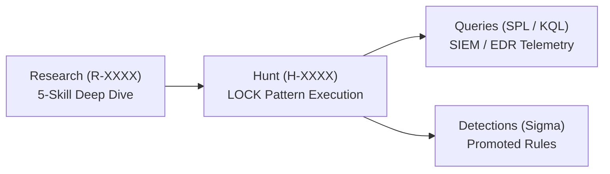

# Hecate Threat Hunting Examples

This directory contains complete, end-to-end example threat hunts following the **LOCK pattern** (Learn → Observe → Check → Keep) and the Hecate workflow:



## Available Examples

| Directory | Topic | Technique | Platform | Artifacts |
|---|---|---|---|---|
| [`01-lsass-memory-credential-dumping`](01-lsass-memory-credential-dumping/) | OS Credential Dumping: LSASS Memory | `T1003.001` | Windows | Research, Hunt, Sigma, SPL |
| [`02-scheduled-task-persistence`](02-scheduled-task-persistence/) | Persistence: Scheduled Task/Job | `T1053.005` | Windows | Research, Hunt, Sigma, KQL |
| [`03-encoded-powershell-execution`](03-encoded-powershell-execution/) | Execution: PowerShell Encoded Commands | `T1059.001` | Windows | Research, Hunt, Sigma, SPL |

---

## How to Use These Examples

1. **Copy into your workspace**:
   ```bash
   # Copy a hunt file to your hunts directory
   cp examples/01-lsass-memory-credential-dumping/hunts/H-0001-lsass-dumping.md hunts/2026/Q4/H-0001.md

   # Copy the corresponding research document
   cp examples/01-lsass-memory-credential-dumping/research/R-0001-lsass-dumping.md research/R-0001.md
   ```

2. **Validate the hunt**:
   ```bash
   hecate-agent hunt validate H-0001
   ```

3. **Promote validated hunting logic into a detection rule**:
   ```bash
   hecate-agent hunt promote --hunt H-0001 --output sigma
   ```

4. **Zero-configuration quickstart**:
   You can also initialize a working demo directly in any clean workspace by running:
   ```bash
   hecate-agent demo init
   ```
